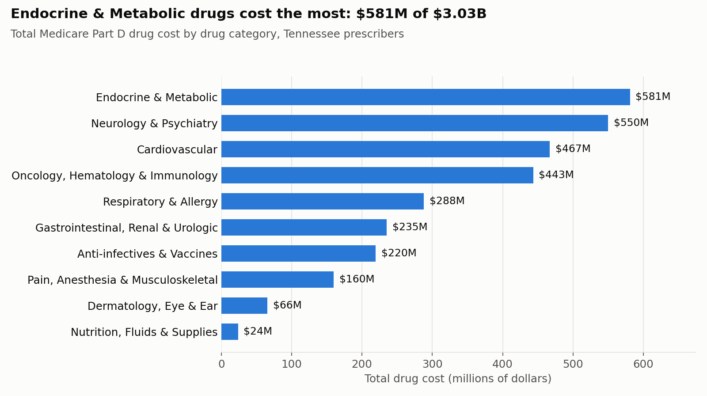
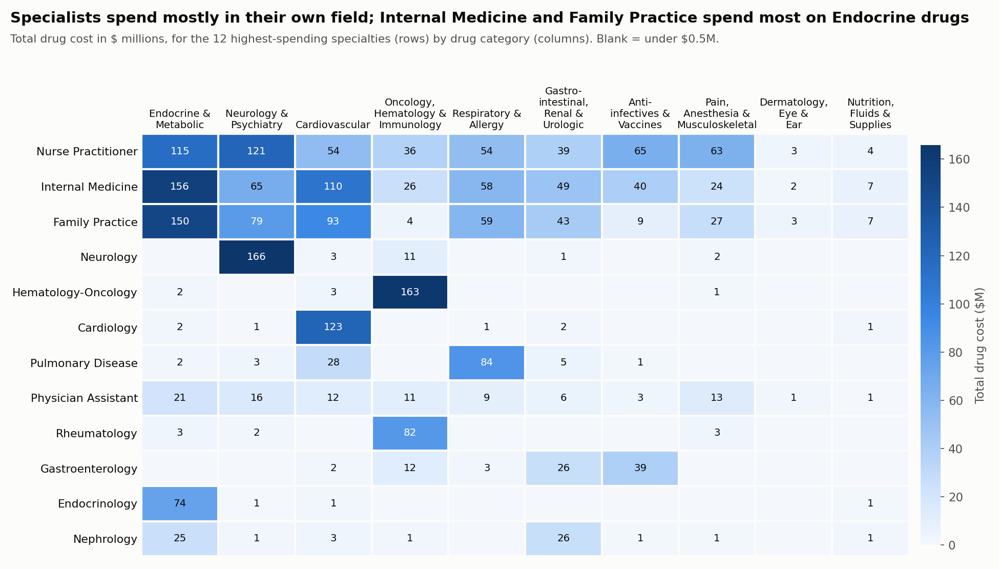

# AI-Assisted Prescribers Project

**Juan Zavala** · PostgreSQL 15 + pgAdmin 4 · working with Claude (Anthropic)

This project answers a set of questions about Medicare Part D prescriptions in Tennessee. The database lists **25,050 prescribers**, of whom 20,592 have prescription rows, and holds **$3.03 billion** in drug costs across **656,058** prescriber-drug rows. Its real subject is **how well an AI assistant does SQL analysis**: where it helped, where it had to be checked, and how to check it.

> **Headline finding:** In Part 3, my first query and Claude's query **did not match**. Mine overstated drug cost by **$83.1 million (2.7%)**. The cause is a trap in the database: `drug_name` repeats in the `drug` table, so joining on it counts some prescriptions 2 to 7 times. Claude's version avoided this, and its totals reconcile to the cent with the raw `prescription` table.

---

## Contents

- [What's in this folder](#whats-in-this-folder)
- [How Claude was used](#how-claude-was-used)
- [Part 1: Testing Claude's understanding](#part-1-testing-claudes-understanding)
- [Part 2: Categorizing 1,787 drugs](#part-2-categorizing-1787-drugs)
- [Part 3: Loading the CSV, then specialty × category](#part-3-loading-the-csv-then-specialty--category)
- [What I learned about working with AI](#what-i-learned-about-working-with-ai)
- [How to reproduce](#how-to-reproduce)
- [Data caveats](#data-caveats)

---

## What's in this folder

| File | What it is |
| --- | --- |
| [`prescribers_analysis.sql`](prescribers_analysis.sql) | **The main submission.** Every query for Parts 1–3, labeled `[ME]` / `[CLAUDE]` / `[CHECK]` / `[NOTE]` |
| [`00_explore_prescribers.sql`](00_explore_prescribers.sql) | First-look profiling of the database: sizes, columns, keys, grain, joins, NULLs |
| [`data/generic_names.csv`](data/generic_names.csv) | Part 2 output: the 1,787 distinct `generic_name` values |
| [`data/drug_categories.csv`](data/drug_categories.csv) | Part 2 output from Claude: `generic_name` → `drug_category` (10 categories) |
| [`results/specialty_category_totals.csv`](results/specialty_category_totals.csv) | Part 3 final answer: 696 specialty × category rows |
| [`images/`](images/) | The two charts below |

**Comment labels in the SQL file**

| Label | Meaning |
| --- | --- |
| `-- [ME]` | A query I wrote myself, before asking Claude |
| `-- [CLAUDE]` | A query Claude provided, followed by its verification statement |
| `-- [CHECK]` | A query that proves whether two answers match (0 rows back = identical) |
| `-- [NOTE]` | Something interesting or surprising |

---

## How Claude was used

1. **Gave Claude the documentation.** I attached `Prescriber_Methodology.pdf` and `ERD.png`, said I was on PostgreSQL 15, and required a verification statement after every answer:
   > *"For each answer you provide, immediately follow it up with a verification of your logic using the support documentation I provided. Answer clearly either confirming you are confident or not confident that your query will answer the question correctly."*
2. **Explored the data before asking anything.** I profiled every table: row counts, which columns are unique, whether joins line up, and where values are NULL. This turned up the two traps that matter later: `drug_name` is not unique, and `bene_count` is suppressed. See `00_explore_prescribers.sql`.
3. **Wrote my own query first, then compared it with Claude's**, as the assignment suggests.
4. **Proved matches on large results** with an `EXCEPT ALL` diff (0 rows means identical) or by reconciling grand totals with the source table. Single-value answers were compared directly.

---

## Part 1: Testing Claude's understanding

| Question | Answer | Claude confident? | Matched mine? |
| --- | --- | :---: | :---: |
| Highest cost per day | **Hematology-Oncology**: $35.31/day | Yes | ✅ |
| Lowest cost per day | **Psychologist, Clinical**: $0.25/day (Surgery is a near-tie at $0.2511 vs $0.2455) | Yes | ✅ |
| Providers per specialty | 107 specialties, 25,050 providers; largest is **Nurse Practitioner** with 6,282 | Yes | ✅ |
| TRUE/FALSE column: has the specialty written prescriptions? | 92 TRUE, 15 FALSE | Yes | ✅ (0-row diff) |
| Most providers, has prescriptions | **Nurse Practitioner**: 6,282 | Yes | ✅ |
| Most providers, no prescriptions | **Undefined Physician type**: 3 | Yes | ✅ |
| Can we find prescriptions to a single beneficiary? | **No.** The data hides counts from 1 to 10 | Yes (that it can't be done) | ✅ |

**Was the verification step useful?** Partly. Claude said "confident" every time, and it happened to be right every time in Part 1. So the statement never warned me about a bad query; the comparison with my own query did that job. Its real value was making Claude **cite the documentation**. For example, it quoted page 5 of the Methodology for the `bene_count` question.

**The single-beneficiary question (Methodology p.5):** `bene_count` values under 11 are blank, and rows with fewer than 11 claims are left out entirely (pp.4 and 18). One beneficiary therefore looks exactly like 2–10. My first try, `WHERE bene_count = 1`, returned **0 rows**, and `MIN(bene_count)` is **11**. Claude still gave a useful query: it lists the **372,306** prescriber-drug rows (from **16,509** prescribers) that have 1–10 beneficiaries. It labeled them candidates, not answers.

**Surprises worth noting**
- The lowest-cost specialties rest on only 1–3 prescription rows each, so they're small-sample results, not patterns.
- The database has **no primary keys, foreign keys or indexes**. A correlated `EXISTS` version of Q3 ran for over 2 minutes; the rewritten versions finish in under a second.

---

## Part 2: Categorizing 1,787 drugs

```sql
SELECT DISTINCT generic_name FROM drug ORDER BY generic_name;   -- 1,787 rows
```

**The README says there should be 1,727 drugs, but the data has 1,787.** I checked whether the extra 60 were near-duplicates; ignoring case and spaces still gives 1,787, so they aren't. I asked Claude for a CSV only, with no API, and it sorted every drug into **10 categories**:

| Category | Drugs | Examples |
| --- | ---: | --- |
| Anti-infectives & Vaccines | 270 | antibiotics, HIV and hepatitis antivirals, antifungals, vaccines |
| Oncology, Hematology & Immunology | 222 | chemotherapy, targeted therapy, biologics, immunosuppressants |
| Neurology & Psychiatry | 212 | antidepressants, antipsychotics, anticonvulsants, ADHD, MS |
| Endocrine & Metabolic | 206 | diabetes, thyroid, hormones and contraceptives, osteoporosis, steroids |
| Nutrition, Fluids & Supplies | 195 | vitamins, IV fluids, electrolytes, syringes, pen needles |
| Cardiovascular | 185 | blood pressure, cholesterol, anticoagulants, diuretics |
| Dermatology, Eye & Ear | 184 | topical steroids, acne, glaucoma drops, ear drops |
| Gastrointestinal, Renal & Urologic | 133 | acid reducers, anti-nausea, laxatives, bladder and prostate |
| Pain, Anesthesia & Musculoskeletal | 101 | opioids, NSAIDs, muscle relaxants, local anesthetics, gout |
| Respiratory & Allergy | 79 | inhalers, antihistamines, cough/cold, allergy extracts |

**How the categories were checked.** The AI's first draft had mistakes, so it went through three checks.

1. **The database's own flags as an answer key.** The `drug` table flags opioids, antibiotics and antipsychotics, so every flagged row is a known answer.
   - All **91** opioid-flagged rows landed in Pain (90) or Neurology & Psychiatry (1).
   - All **179** antibiotic rows landed in Anti-infectives (176) or topical/eye products (3).
   - All **59** antipsychotic rows landed in Neurology & Psychiatry.
2. **Two review passes fixed 15 mistakes before the final load.**
   - **5 were caught by a test load.** For example, diabetic **pen needles** had been put in Anti-infectives, because the word "PEN" matched penicillin.
   - **10 were caught by an independent second Claude review** of all 1,787 rows. For example, **gatifloxacin** is only sold as an eye drop, and **BCG Live** treats bladder cancer rather than being a vaccine.
3. **Settling disputes with the data itself.** Where a drug could fit two categories, the deciding question was which specialties actually prescribe it. For example, fluorouracil is prescribed mostly by Dermatology (107 rows), so it's the skin cream, not the IV chemotherapy.

---

## Part 3: Loading the CSV, then specialty × category

**Loading the CSV (Claude's directions)**

1. Create the table:
   ```sql
   CREATE TABLE drug_category (
       generic_name  TEXT PRIMARY KEY,
       drug_category TEXT NOT NULL
   );
   ```
2. In pgAdmin, right-click the table → **Import/Export Data** → **Import** → choose `data/drug_categories.csv`. Set Format to `csv`, turn **Header** on and set Quote to `"`, because some category names contain commas.
3. Check the load: 1,787 rows, and every drug in `drug` finds a category (0 unmatched).

**The question:** what are `total_day_supply` and `total_cost` (as money) for each specialty / drug category combination?

**Did the results match? No.**

| | My first attempt | Claude's query | Raw `prescription` table |
| --- | ---: | ---: | ---: |
| Rows summed | 705,015 | **656,058** | 656,058 |
| Total cost | $3,116,214,457.86 | **$3,033,110,804.42** | $3,033,110,804.42 |
| Total day supply | 1,607,115,938 | **1,523,661,845** | 1,523,661,845 |
| Specialty × category rows | 697 | **696** | n/a |

**Why they differ.** `prescription` only stores `drug_name`, and `drug_name` is **not unique** in `drug`: 120 names appear more than once, some up to 7 times (`SODIUM CHLORIDE`, `INSULIN SYRINGE`). My straightforward join copied each of those prescriptions once for every matching row:

```sql
-- [ME] counts repeated drug_names 2-7 times
FROM prescription p1
JOIN prescriber    p2 ON p2.npi = p1.npi
JOIN drug          d  ON d.drug_name = p1.drug_name      -- one prescription row can match many drug rows
JOIN drug_category c  ON c.generic_name = d.generic_name
```

Claude first narrowed the drug list to **one category per drug_name**, and then joined:

```sql
-- [CLAUDE] counts every prescription exactly once
WITH drug_name_category AS (
    SELECT d.drug_name, MIN(c.drug_category) AS drug_category
    FROM drug d JOIN drug_category c ON c.generic_name = d.generic_name
    GROUP BY d.drug_name
)
SELECT r.specialty_description, dc.drug_category,
       SUM(p.total_day_supply)       AS total_day_supply,
       SUM(p.total_drug_cost)::MONEY AS total_cost
FROM prescription p
JOIN prescriber         r  ON r.npi = p.npi
JOIN drug_name_category dc ON dc.drug_name = p.drug_name
GROUP BY r.specialty_description, dc.drug_category;
```

**What the double counting changed:**
- **359 of 697 combinations** came out wrong in my version.
- The biggest errors were in **diabetic supplies**. For example, Internal Medicine / Nutrition, Fluids & Supplies shows **$19.8M** in my version against **$7.3M** in Claude's.
- My version also invents one combination, Surgical Oncology / Dermatology. A single `ERYTHROMYCIN` prescription was counted under both erythromycin generics (tablets and gel), so it landed in two categories.

The final answer is Claude's query, because its totals reconcile with the source table to the cent.

### What the final table shows



Endocrine & Metabolic drugs (mostly diabetes) cost the most, at **$581M**. Nutrition, Fluids & Supplies cost the least, at $24M.



- **Specialists spend in their own field.** Neurology puts $166M into Neurology & Psychiatry, Hematology-Oncology $163M into Oncology, and Cardiology $123M into Cardiovascular.
- **Primary care's largest cost is Endocrine & Metabolic**: Internal Medicine $156M, Family Practice $150M.
- **Gastroenterology's top category is Anti-infectives ($39M), not GI drugs.** That's hepatitis C treatment: Harvoni prescribed by gastroenterologists alone comes to $26.1M.

| Top 5 combinations | Total cost |
| --- | ---: |
| Neurology / Neurology & Psychiatry | $165.8M |
| Hematology-Oncology / Oncology, Hematology & Immunology | $163.4M |
| Internal Medicine / Endocrine & Metabolic | $155.8M |
| Family Practice / Endocrine & Metabolic | $149.9M |
| Cardiology / Cardiovascular | $123.2M |

---

## What I learned about working with AI

| | |
| --- | --- |
| **Where Claude helped most** | Reading a 28-page methodology PDF and applying it (the `bene_count` limit). Spotting that `drug_name` isn't unique. Categorizing 1,787 drugs in minutes. Writing pgAdmin import steps. |
| **Where it needed checking** | Its first drug categories had 15 errors, a few of them clear-cut (pen needles filed as antibiotics). It also takes the question's wording literally; "most providers" could mean two different things, and only one gets answered unless you ask. |
| **The verification statement** | It cited the documentation, which was useful, but it said "confident" every time. Confidence isn't proof. |
| **What actually caught errors** | Checks that don't depend on the AI's opinion: `EXCEPT ALL` diffs, reconciling grand totals with the source table, the database's own drug flags, and a second AI review of the first one's work. |
| **Biggest takeaway** | Know your data's grain *before* you join. One unchecked join inflated a $3B total by $83M, and nothing looked wrong until the totals were reconciled. |

---

## How to reproduce

1. Restore `data/prescribers.backup` (in the repo root) into a database named `prescribers`. In pgAdmin: right-click the database → Restore, Format `Custom or tar`, and set Owner and Privileges to **Do not save**.
2. Open `prescribers_analysis.sql` in the Query Tool. Run it **one query at a time**: highlight a query, then press F5.
3. In Part 3 Step 1, create the `drug_category` table and import `data/drug_categories.csv` as described there.
4. Every `[CHECK]` query should return what its comment says. For example, the Q3 diff returns 0 rows, and Claude's grand total is $3,033,110,804.42.

## Data caveats

- **Partial data:** CMS drops prescriber-drug rows with fewer than 11 claims, so all totals are lower than true Medicare spending (Methodology p.18).
- **Cost isn't what Medicare paid:** `total_drug_cost` includes amounts paid by the plan, the patient and third parties, and doesn't account for manufacturer rebates (pp.17–18).
- **Specialty is assigned:** it comes from the specialty on each NPI's Part B claims, or from NPPES. A provider has exactly one, even if they practice more than one (p.5).
- **One category per drug:** some generic names cover several forms of a drug (hydrocortisone tablets and rectal cream). Three drug names (`ERYTHROMYCIN`, `HYDROCORTISONE`, `SODIUM CHLORIDE`) span two categories and can't be split from prescription data. Each is assigned to one category so nothing is counted twice.

---

<sub>Analysis built with Claude (Anthropic) as a pair-analyst. Every number in this README was checked with SQL against the database (most of those queries are in `prescribers_analysis.sql`), then re-verified by an independent review before submission.</sub>
